# Sobremesa Dinners

**[sobremesadinners.com](https://www.sobremesadinners.com)**

Small dinners in San Francisco and Berkeley where three Latino professionals share their stories with 7–12 MBA students around one table. Daniela Olavarrieta and I started Sobremesa at Berkeley Haas. This repo is everything behind it: the public site, the sign-up forms, and an admin portal that runs each dinner from the first speaker invite to the thank-you email the morning after.

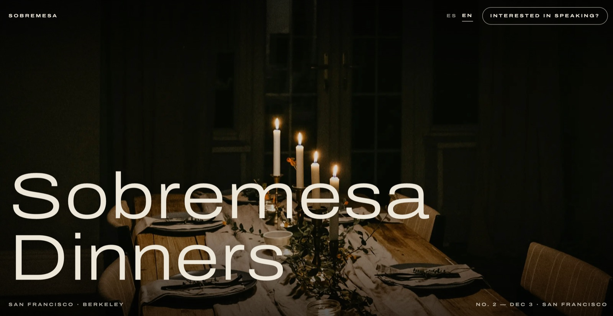

I built this site to take on the tedious administrative parts of planning recurring events, and to add personal touches that professionalize it and give emotional depth to something we hope is valuable to the professional Latino community in the Bay.

## What it does

**For guests.** A bilingual site (Spanish first, English toggle) with upcoming and past dinners, a speaker sign-up with an availability calendar, and a student application with a 200-word essay. Each past dinner gets its own page with photos and quotes from the night.

<p>
  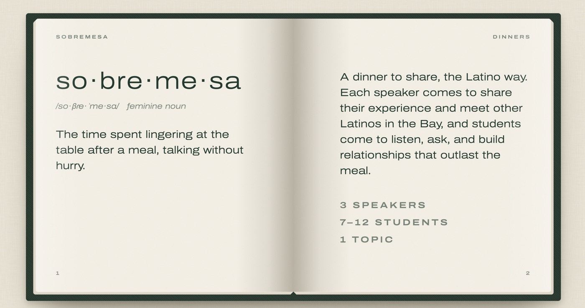
  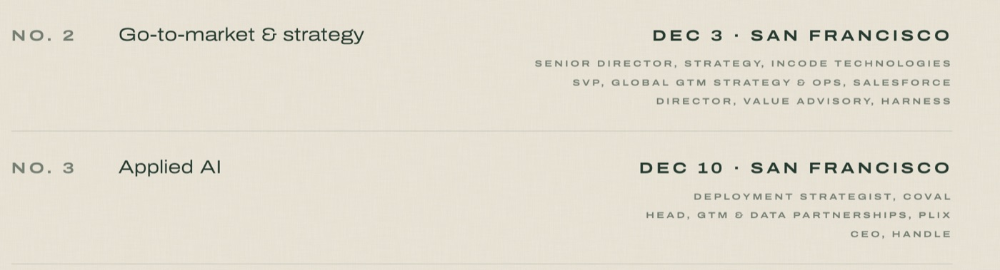
</p>

**Personal links.** Speakers we already know get an invite link with up to three tentative dates to pick from. Students get links to confirm their seat and, after the dinner, to leave feedback. Nobody makes an account.

<p>
  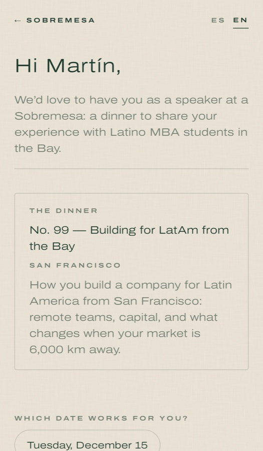
  &nbsp;
  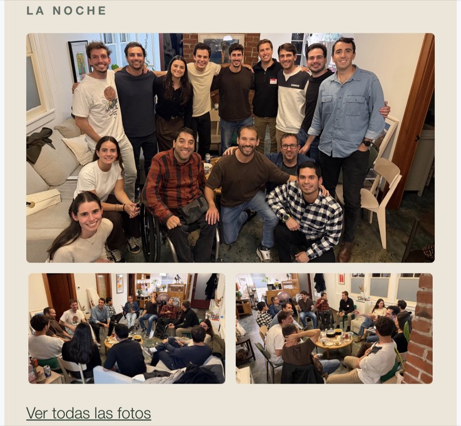
</p>

**Seven emails per dinner.** Each guest gets the right email at the right time: a confirmation for speakers, the details a week before (with a Venmo link for students), the address the day before, and photos plus a feedback form at 8am the next morning. The admins edit the subject and opening paragraph in both languages, preview it as any recipient, and send it. The rest of each email is built from the dinner's data.

<p>
  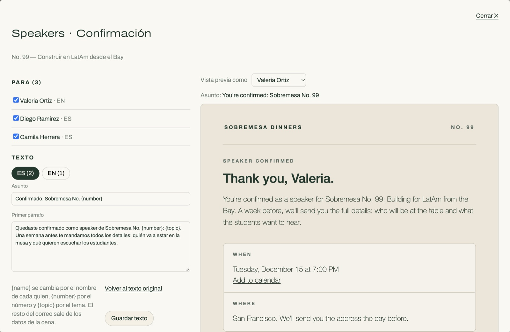
  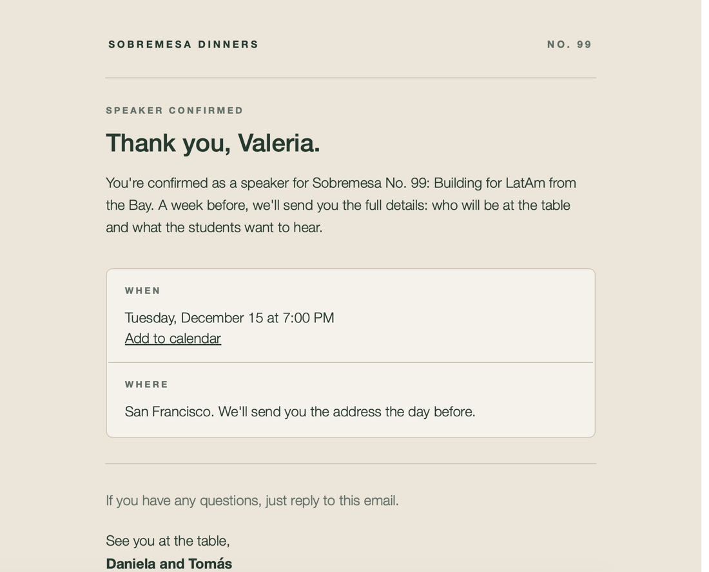
</p>

**An admin portal instead of a spreadsheet.** Each dinner has one panel: speakers confirmed, students accepted and paid, and every email with its status (scheduled, due, sent). A cron job emails both of us each morning with what's due and who hasn't paid, and the same items show up as a badge in the portal. The portal also generates a square flyer for Instagram from the dinner's data.

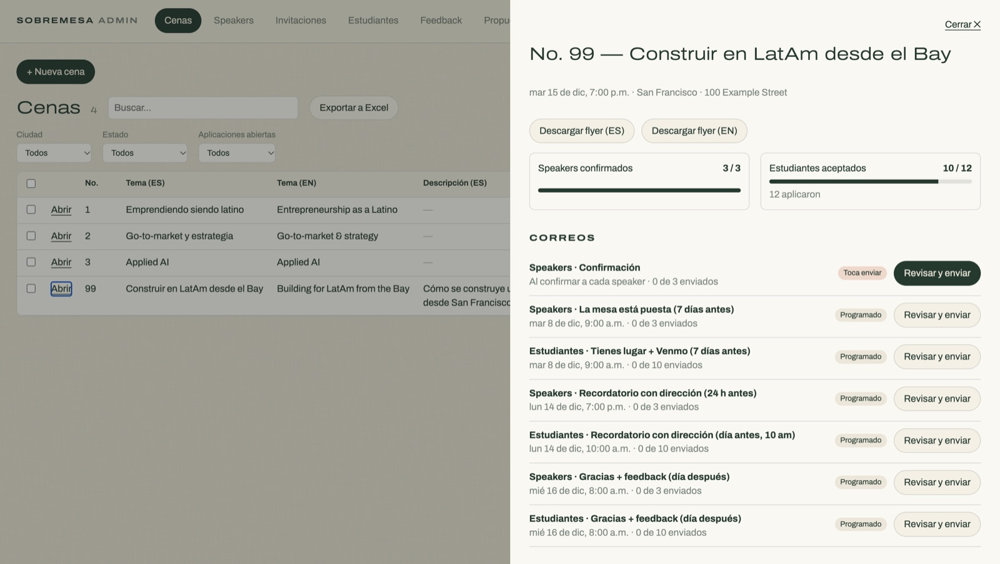

<p>
  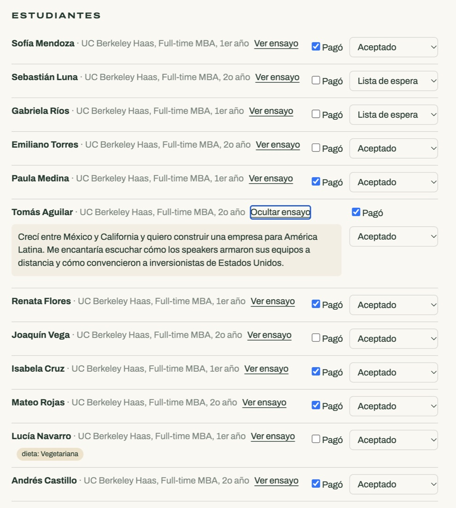
  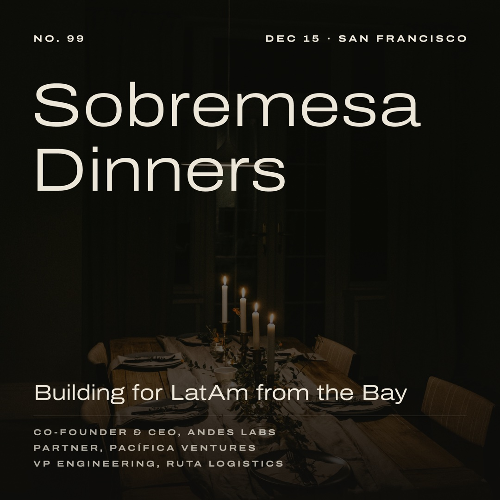
</p>

> The admin screenshots show a demo dinner (No. 99) with made-up guests.

## How it's built

**Stack:** Next.js 16 (App Router, React 19, TypeScript) · Supabase (Postgres, Auth, Storage) · Resend · Vercel

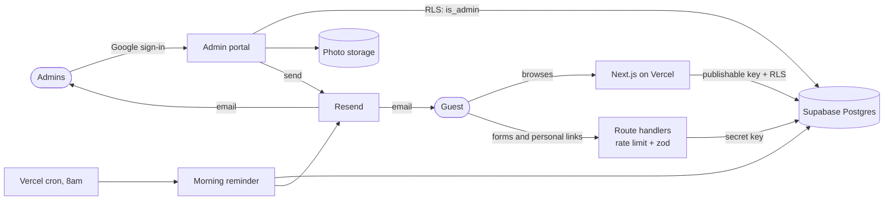

Some decisions I'd point to:

- **The database decides who sees what.** Every table has row-level security. The browser only has the publishable key, which can read published dinners and nothing else. Public forms go through server route handlers that validate with zod and then write with the secret key. The admin portal talks to Postgres directly and relies on RLS (`is_admin()`), so there's no separate admin API to keep in sync.
- **The email logic is plain functions.** What's due, who receives it, and how it renders all live in [`src/lib/emails/`](src/lib/emails) with no server or browser code, so they're unit-tested directly. That includes Pacific-time scheduling across the daylight-saving change and HTML escaping of anything a guest typed.
- **Nothing is sent automatically to guests.** The cron job only reminds the admins, and a person reviews and sends each email. For a dinner series built on personal relationships, a wrong automated email costs more than a click saves.
- **Small guardrails where they count.** Public forms are rate-limited by a hashed IP in Postgres, have a honeypot field, and the essay word limit is enforced in the textarea, the API and a database constraint. Uploaded photos are resized in the browser before upload (about 1 MB → 140 KB).
- **Checks on every pull request.** Lint, typecheck, 60+ unit tests and a production build run in GitHub Actions. Two people work on the repo through branches and pull requests ([CONTRIBUTING.md](CONTRIBUTING.md)).

## Running it

Setup, environment variables, the access policy and deploy notes are in [docs/SETUP.md](docs/SETUP.md). The short version:

```bash
npm install
npm run dev   # renders with placeholder dinners; forms need a Supabase project
```

## Credits

Built by Tomás Diez Canedo with Daniela Olavarrieta, co-founder of Sobremesa Dinners.
[linkedin.com/in/tomas-diez](https://www.linkedin.com/in/tomas-diez/)
